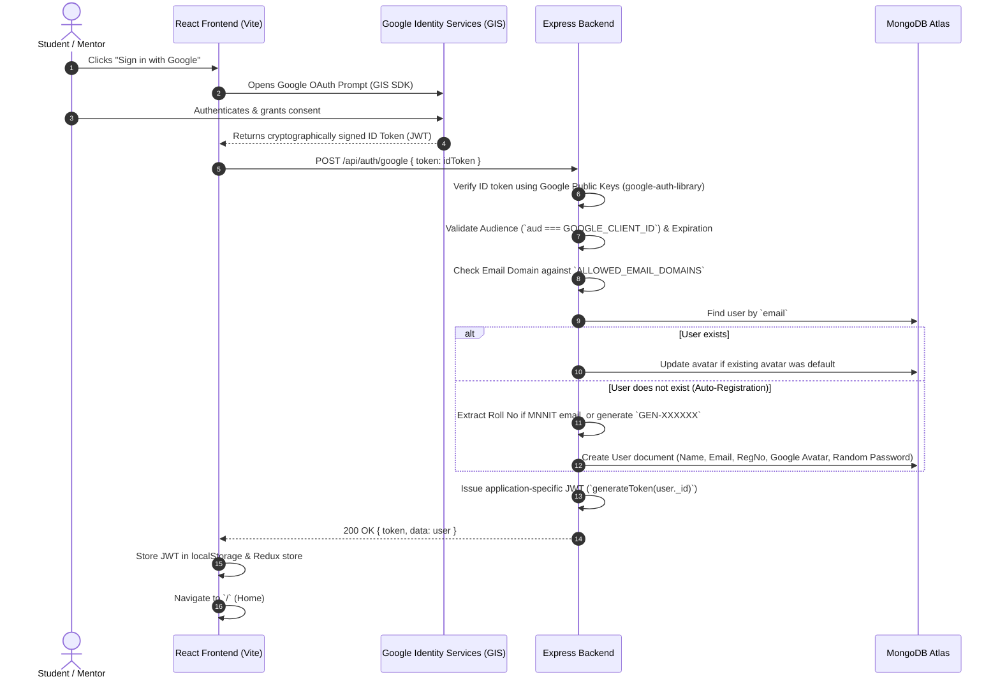

# Google Authentication & Identity Architecture
## Technical Documentation & Interview Preparation Guide

---

## 1. System Overview

SMP Hub implements **Federated Identity Management** using Google Identity Services (GIS), combining **OpenID Connect (OIDC)** with an internal **JWT-based session management system**.

This allows seamless, one-click authentication for students and mentors using either their institutional Google Workspace accounts (`@mnnit.ac.in`) or personal Google accounts (`@gmail.com`), with automated registration number extraction and profile synchronization.

---

## 2. Architecture & Authentication Flow

---

## 3. Key Architectural Components

### A. Client-Side (React + `@react-oauth/google`)
* **Component:** `GoogleAuthButton.jsx`
* Wraps Google's official One-Tap / Pop-up button in a dark glassmorphic card matching the SMP theme.
* Passes the signed credential string (`credentialResponse.credential`) to `/api/auth/google`.
* Gracefully degrades if `VITE_GOOGLE_CLIENT_ID` is unconfigured without breaking other page elements.

### B. Server-Side Verification (`google-auth-library`)
* **Controller:** `googleAuth` in `backend/controllers/auth.js`
* Uses Google's `OAuth2Client.verifyIdToken()` which caches Google's public certificates (JWKS) to verify signatures locally without making an HTTP request to Google for every single login.

### C. Smart Registration Number (`regNo`) Resolution
1. **Institutional MNNIT Emails (`name.<regNo>@mnnit.ac.in`):**
   * Pattern: `/^([a-z0-9-]+)\.([0-9]{8})@mnnit\.ac\.in$/i`
   * Extracts the 8-digit roll number automatically (e.g. `suresh.20230000@mnnit.ac.in` $\to$ `20230000`).
2. **General Emails (`@gmail.com`, etc.):**
   * Generates a unique generic registration number prefixed with `GEN` followed by random digits (e.g. `GEN582914`).
   * Queries MongoDB before saving to guarantee zero database collisions on the unique `regNo` index.

---

## 4. Top 10 Technical Interview Questions & Answers

### Q1: What is the difference between OAuth 2.0 and OpenID Connect (OIDC)?
> **Answer:** 
> * **OAuth 2.0** is an **authorization** framework designed to grant third-party applications access to user resources without sharing user passwords (it issues *Access Tokens*).
> * **OpenID Connect (OIDC)** is an **authentication** layer built on top of OAuth 2.0. It standardizes identity by issuing an **ID Token** (a signed JSON Web Token), containing verifiable claims about the user (identity, email, name, avatar).
> * In our app, we use **OIDC** to verify *who* the user is, not to manage Google Drive or external resources.

---

### Q2: How does the backend verify the Google ID token without calling Google's API on every request?
> **Answer:**
> Google publishes its public JSON Web Key Sets (JWKS) at `https://www.googleapis.com/oauth2/v3/certs`. 
> The `google-auth-library` caches these public keys in memory and performs asymmetric cryptographic verification (RS256) locally:
> 1. Verifies the cryptographic signature using Google's public key.
> 2. Verifies the token issuer (`iss`) is `accounts.google.com`.
> 3. Verifies the audience (`aud`) matches our specific `GOOGLE_CLIENT_ID`.
> 4. Verifies the token has not expired (`exp`).

---

### Q3: What is the "Audience Check" (`aud`) and why is it a critical security requirement?
> **Answer:**
> If we did not verify the `aud` claim, a malicious actor could create their own malicious app, trick a user into signing into *their* app, intercept that Google ID token, and send it to our backend. 
> Because the token was signed by Google, the signature would be valid, but checking that `aud === process.env.GOOGLE_CLIENT_ID` ensures that the user explicitly authorized **our specific application**, preventing cross-application token reuse attacks.

---

### Q4: Why don't you use Google's ID Token directly as your application's session token?
> **Answer:**
> Google ID tokens have a short lifespan (typically 1 hour) and contain Google-specific claims. 
> Exchanging it for an application-specific JWT gives us:
> 1. Complete control over token expiry, payload claims (`user._id`, role permissions like mentor vs. student).
> 2. Decoupling from Google's infrastructure: our internal APIs and WebSocket connections verify our own secret key (`JWT_SECRET`) without relying on Google certificates.
> 3. Standardized auth: manual email/password users and Google OAuth users both end up with identical session formats.

---

### Q5: How did you solve the constraint where MNNIT requires roll numbers, but Gmail doesn't have them?
> **Answer:**
> We engineered a dual-mode identity resolver:
> 1. For institutional emails (`@mnnit.ac.in`), we run regex pattern matching on the email structure (`name.<regNo>@mnnit.ac.in`) to extract the student's authentic 8-digit roll number.
> 2. For external testing emails (`@gmail.com`), our backend dynamically generates a unique registration identifier (`GEN-XXXXXX`) after checking for collision against MongoDB's unique index. This allows frictionless developer testing while preserving strict data integrity for college cohorts.

---

### Q6: What happens if a user signs in with Google, but their email domain is restricted?
> **Answer:**
> Even if Google successfully authenticates the user, our backend enforces policy via `ALLOWED_EMAIL_DOMAINS`. 
> After decoding the verified email claim, our backend checks whether the domain is permitted. If an unauthorized domain attempts login (e.g. `@yahoo.com` when only `@mnnit.ac.in` is whitelisted), the backend rejects the request with HTTP `400 Bad Request`, preventing unauthorized account creation.

---

### Q7: How does your database prevent duplicate user accounts if someone signs up with email/password and later clicks "Sign in with Google"?
> **Answer:**
> The `email` field has a unique index in MongoDB (`unique: true`). 
> In `googleAuth`, we perform an atomic `User.findOne({ email })`:
> * If the email exists, we link the session and log them in, also updating their profile photo to their Google avatar if they were previously using a default avatar.
> * If the email does not exist, only then do we invoke the registration path.

---

### Q8: What password is stored in MongoDB for Google OAuth users?
> **Answer:**
> Google never exposes the user's password to third-party applications. 
> For auto-registered OAuth users, we generate a cryptographically strong, random entropy string hashed with `bcrypt` (10 salt rounds). The user never needs to know this password because they authenticate via Google OIDC. If they ever need to log in manually, they can use the "Reset Password" flow.

---

### Q9: What are the security advantages of using Google Identity Services over traditional passwords?
> **Answer:**
> 1. **Protection against Credential Stuffing & Phishing:** Google handles multi-factor authentication (MFA/2FA), hardware security keys, and suspicious login detections.
> 2. **Zero Password Storage Risk:** We do not hold real user credentials for Google users in our database, minimizing exposure in the event of a database breach.
> 3. **Verified Email:** Google guarantees that `email_verified: true`, eliminating fake or disposable email accounts.

---

### Q10: How does this implementation affect Frontend Core Web Vitals?
> **Answer:**
> Google's client script is loaded asynchronously without blocking main thread parsing. In our Vite build configuration, vendor code is split into distinct cached chunks, ensuring that adding the OAuth library does not cause bundle bloat or layout shifts (Cumulative Layout Shift remains 0).

---

## 5. Quick Verification Checklist

* [x] `google-auth-library` installed in `backend/package.json`
* [x] `@react-oauth/google` installed in `frontend/package.json`
* [x] Backend route `/api/auth/google` handles token verification & auto-registration
* [x] Institutional roll number auto-extracted from `@mnnit.ac.in` emails
* [x] Generic roll number (`GEN-XXXXXX`) assigned to non-institutional emails
* [x] Google profile image automatically linked to user profile
* [x] `VITE_GOOGLE_CLIENT_ID` and `GOOGLE_CLIENT_ID` documented in `.env.example`
