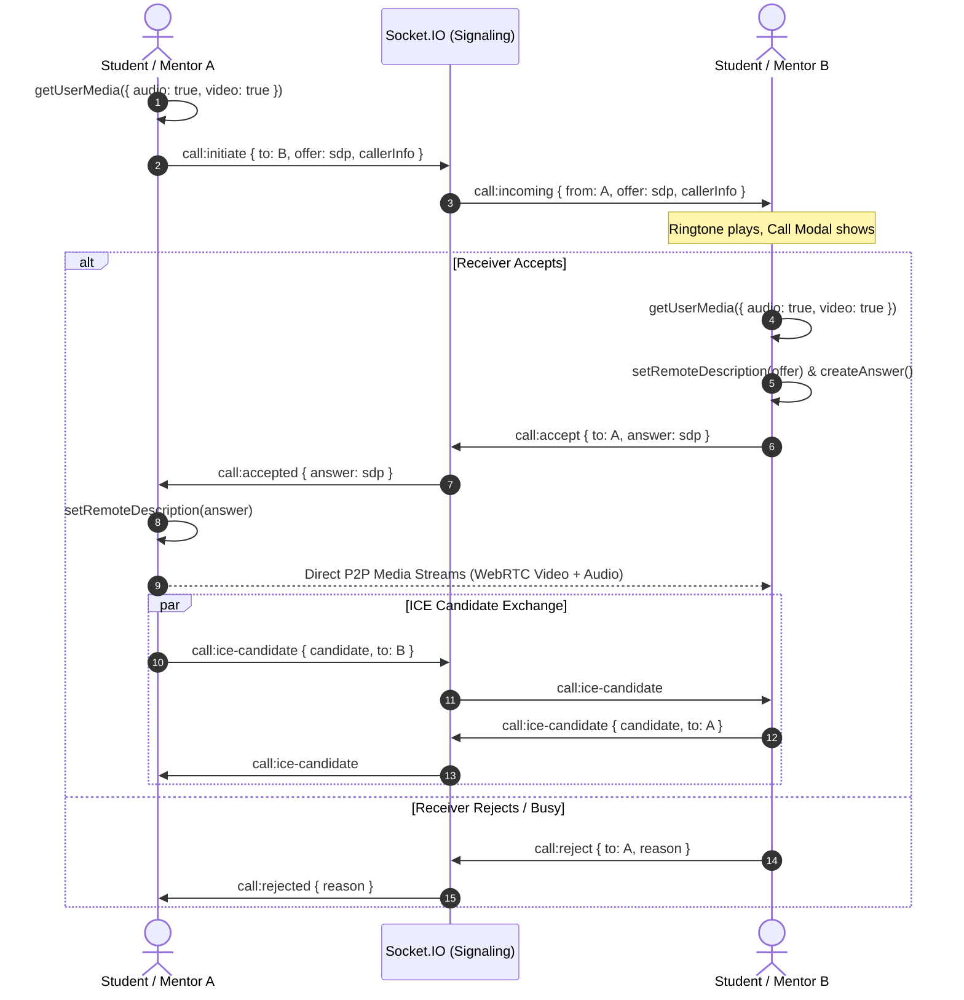
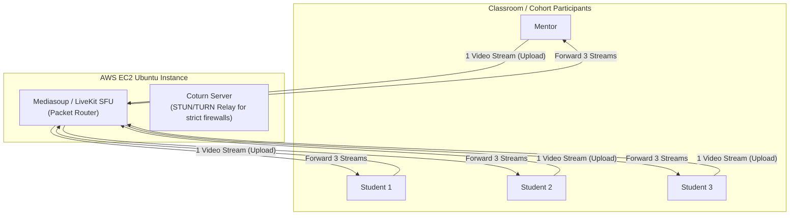

# Audio & Video Calling Architecture & Implementation Roadmap
## 1-on-1 WebRTC (Audio + Video) to AWS-Powered Group SFU

---

## 1. Executive Summary

This document outlines the phased engineering blueprint for adding real-time **audio and video calls** to **SMP Hub**:

* **Phase 1 (Immediate):** Direct **1-on-1 Peer-to-Peer (P2P) WebRTC calling** supporting both **dedicated voice/audio calls** and **HD video calls** using the existing Node.js Socket.IO server as the signaling plane. Zero additional infrastructure costs, sub-25ms latency, and 0% server media bandwidth consumption.
* **Phase 2 (Scale):** **Group Audio & Video Conferences** for cohorts and mentorship meetings using a self-hosted **Selective Forwarding Unit (SFU)** deployed on an **AWS EC2 Ubuntu instance** with an integrated **Coturn (STUN/TURN)** server.

---

## 2. Phase 1: 1-on-1 P2P Video Calling Architecture

### A. How It Works
WebRTC (Web Real-Time Communication) is a browser-native standard. In a 1-on-1 call, video and audio streams travel **directly between the two users' browsers** via UDP. The backend server only acts as a matchmaker (signaling server) during the first 1–2 seconds to exchange connection metadata.



---

### B. Audio Call vs. Video Call Modes

WebRTC uses the identical `RTCPeerConnection` pipeline for both audio and video, with different initial constraints and dynamic track toggling:

| Mode | Media Constraints | Network Bandwidth | UI Display |
| :--- | :--- | :--- | :--- |
| **Audio-Only Call** | `{ audio: true, video: false }` | ~30–50 kbps (OPUS codec) | Minimal avatar pulse view with waveform / speaking indicator |
| **Video Call** | `{ audio: true, video: true }` | ~800–1500 kbps (VP8/H.264) | Full HD video feed + Picture-in-Picture local camera view |

#### Dynamic In-Call Upgrading:
* A student on an **Audio Call** can tap *"Turn Camera On"* $\to$ requests camera track via `getUserMedia({ video: true })` and hot-adds the track via `peerConnection.addTrack()`, smoothly upgrading to a video call without hanging up.
* Users can toggle **Mute Mic**, **Camera On/Off**, and **Screen Share** at any moment.

| Event Name | Direction | Payload | Purpose |
| :--- | :--- | :--- | :--- |
| `call:initiate` | Client $\to$ Server | `{ receiverId, caller, offer, isVideo }` | Caller requests call and provides SDP offer |
| `call:incoming` | Server $\to$ Client | `{ caller, offer, isVideo }` | Receiver receives call invite modal |
| `call:accept` | Client $\to$ Server | `{ callerId, answer }` | Receiver accepts and sends SDP answer |
| `call:accepted` | Server $\to$ Client | `{ answer }` | Caller finalizes peer connection |
| `call:ice-candidate` | Bidirectional | `{ targetUserId, candidate }` | Relays network routing candidates |
| `call:end` | Bidirectional | `{ targetUserId }` | Terminates call and releases media hardware |
| `call:reject` | Client $\to$ Server | `{ callerId, reason }` | Informs caller that call was declined |

---

### C. STUN Configuration (NAT Traversal)
For 1-on-1 calls, Google provides free public STUN servers that resolve public IP/port bindings:
```javascript
const rtcConfig = {
  iceServers: [
    { urls: "stun:stun.l.google.com:19302" },
    { urls: "stun:stun1.l.google.com:19302" }
  ]
};
```

---

### D. Frontend Components to Implement
1. **`CallModal.jsx` (Incoming Call Alert):**
   * Shows caller name and avatar.
   * Plays incoming ringtone.
   * Audio Accept, Video Accept, and Decline buttons.
2. **`VideoRoom.jsx` (In-Call Interface):**
   * Large remote video feed + Picture-in-Picture (PiP) local preview.
   * Control Toolbar: Mic toggle (mute/unmute), Camera toggle, Screen Share toggle, End Call.
   * Call timer indicator and connection health status.
3. **`useWebRTC.js` (Custom Hook):**
   * Encapsulates `RTCPeerConnection` lifecycle, `navigator.mediaDevices.getUserMedia()`, track toggling, and cleanup.

---

## 3. Phase 2: Group Calling via AWS SFU (Next Step)

### Why 1-on-1 P2P Mesh Fails for Groups
In a mesh call with $N$ participants, each user sends $N-1$ streams and receives $N-1$ streams.
* For 2 users: 1 upload, 1 download (Effortless).
* For 8 users: 7 uploads, 7 downloads $\to$ **49 active video pipelines!** A student's laptop CPU will overheat, and home internet bandwidth will choke.

---

### The Solution: Selective Forwarding Unit (SFU) on AWS



#### How the SFU Architecture Works:
1. **Upload Once:** Each participant encodes and uploads their audio and video **exactly once** to the SFU server.
2. **Intelligent Forwarding:** The SFU does not re-encode video (saving server CPU); it inspects incoming media packets and routes copies to everyone in the room.
3. **Simulcast Support:** Clients send 3 quality layers (180p, 360p, 720p). The SFU forwards 720p for the active speaker (large tile) and 180p for grid thumbnails, saving 70% client bandwidth.

---

### AWS Deployment Plan (Using AWS Student Credits)

1. **EC2 Instance:** Ubuntu `t3.medium` or `t4g.small` (ARM-based, very cost-effective).
2. **Elastic IP:** Attach a static public IPv4 address to the instance.
3. **Security Group Configuration:**
   * TCP `22` (SSH management)
   * TCP/UDP `3478` (Coturn STUN/TURN listening port)
   * TCP `443` (Secure WebSocket signaling)
   * UDP `10000–20000` (WebRTC media stream port range)
4. **Coturn Installation:**
   * Acts as the TURN relay when students connect from strict campus proxies or symmetric 4G/5G mobile NATs where direct P2P fails.

---

## 4. Technical Interview Talking Points

### Q: Why start with P2P for 1-on-1 before deploying an SFU?
> **Answer:** 
> "For 1-on-1 mentor sessions, direct P2P WebRTC is technically superior to routing through a server: it delivers lower latency (direct routing), higher privacy (end-to-end media encryption), and zero server bandwidth costs. By implementing P2P first, we establish robust media device management, signaling contracts, and UI state machines before tackling the distributed networking complexities of an SFU."

### Q: What is the difference between an SFU and an MCU?
> **Answer:**
> * An **MCU (Multipoint Control Unit)** decodes and mixes all incoming video feeds on the server into a single composite video frame (like a television broadcast). It requires immense server CPU.
> * An **SFU (Selective Forwarding Unit)** acts as an intelligent packet router. It forwards compressed media packets without decoding or re-encoding them, allowing a single modest virtual machine to handle dozens of concurrent participants with minimal latency.

### Q: How does WebRTC handle NAT traversal?
> **Answer:**
> WebRTC uses the **ICE (Interactive Connectivity Establishment)** framework:
> 1. It gathers local host candidates (internal IP).
> 2. It queries a **STUN server** to discover its public reflection address.
> 3. If direct peer-to-peer connection is blocked by symmetric NATs (common on cellular data or university firewalls), it falls back to a **TURN relay server** to forward packets through an authorized relay port.

---

## 5. Execution Roadmap

* [x] **Architecture Plan & Documentation:** Complete (`docs/VIDEO_CALL_ARCHITECTURE_AND_ROADMAP.md`).
* [x] **Step 1 (Signaling):** Add 1-on-1 calling events to `backend/socket.js`.
* [ ] **Step 2 (Frontend State & Hook):** Build `useWebRTC` hook with local/remote stream lifecycle.
* [ ] **Step 3 (UI):** Add Call button in Chat Header, Incoming Call Modal, and Floating Video Call View.
* [ ] **Step 4 (Phase 2 SFU):** Deploy Mediasoup / LiveKit SFU on AWS EC2 for group rooms.
